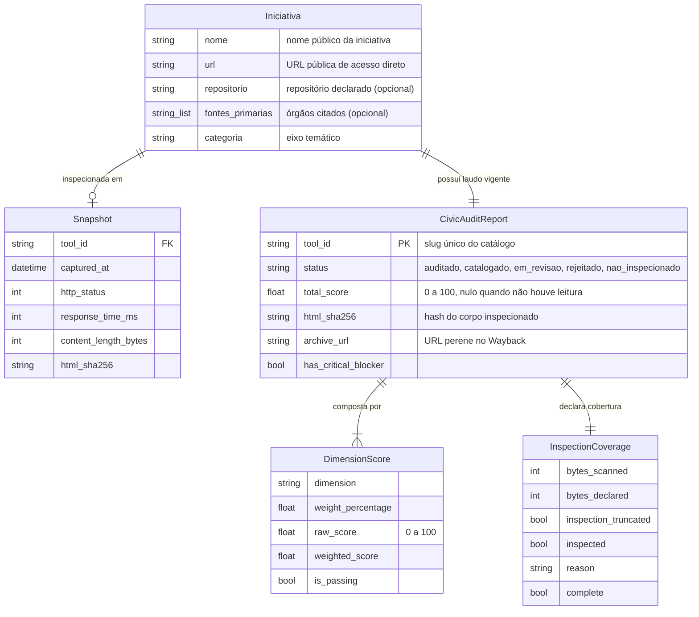

# Data Model: Pipeline de Monitoramento e Avaliação Cívica

**Feature**: `001-pipeline-monitoramento`
**Atualizado em**: 2026-10-23

Este documento descreve as entidades de dados do Protocolo de Avaliação Cívica TecnoPopular e é
o contrato público do laudo e do manifesto de estado. A fonte de verdade é
`src/observatorio/models.py`; quando este documento e o código divergirem, o código está certo e
este arquivo deve ser corrigido.

---

## 1. Diagrama de Entidades



---

## 2. Modelos Pydantic

### 2.1 `Iniciativa` — registro do catálogo

```python
class Iniciativa(BaseModel):
    tool_id: str
    nome: str
    url: str
    dominio: Optional[str] = None
    categoria: Optional[str] = "Iniciativa Cívica"
    descricao: Optional[str] = ""
    repositorio: Optional[str] = None
    fontes_primarias: Optional[List[str]] = Field(default_factory=list)
    adicionado_em: Optional[date] = None
```

O catálogo em `data/data_iniciativas.json` é a entrada da esteira. `fontes_primarias` é o único
campo que declara fonte oficial: o motor não infere fonte a partir de `descricao`.

`tool_id` é gravado na entrada e não recalculado: ele nomeia `auditoria/<tool_id>.html`, a entrada do
manifesto e o diretório de cache. Entradas sem `tool_id` gravado, herdadas de antes desse campo,
recebem o valor derivado do nome no primeiro ciclo; a partir daí o valor é estável, e corrigir o nome
não muda o endereço do laudo. Nomes repetidos continuam gerando identificadores distintos por sufixo
ordinal (`nome-repetido`, `nome-repetido-2`), atribuídos na inclusão.

`categoria` e `descricao` são **texto editorial**: nenhuma dimensão da nota os lê, e o motor não os
valida contra lista fechada. A navegação e o texto de apresentação pertencem ao catálogo publicado; o
que este repositório garante é identidade (`tool_id`) e as fontes declaradas (`fontes_primarias`),
este último o único campo cadastral que entra na pontuação.

`adicionado_em` registra quando a iniciativa entrou no acervo. Fica ausente nas entradas anteriores
ao campo, e não é preenchido retroativamente com data estimada.

Antes de cada ciclo, o catálogo passa por validação: entrada sem nome ou URL, URL sem esquema
HTTP(S), URL com fragmento, dois registros do mesmo endereço e dois registros com o mesmo `tool_id`
interrompem a execução com a lista de problemas, em vez de descartar iniciativas em silêncio.

### 2.2 `Snapshot` — registro transitório da aquisição

```python
class Snapshot(BaseModel):
    tool_id: str
    captured_at: datetime
    http_status: int
    response_time_ms: int
    content_length_bytes: int
    html_sha256: str
```

### 2.3 `InspectionCoverage` — quanto foi efetivamente lido

```python
class InspectionCoverage(BaseModel):
    bytes_scanned: int = 0
    bytes_declared: Optional[int] = None
    byte_coverage: Optional[float] = Field(None, ge=0.0, le=1.0)
    text_chars_scanned: int = 0
    text_chars_total: int = 0
    text_truncated: bool = False
    inline_scripts_truncated: bool = False
    inspection_truncated: bool = False
    inspection_limit_bytes: Optional[int] = None
    inspected: bool = True
    reason: Optional[str] = None
    complete: bool = True
```

Duas limitações independentes compõem `complete`: o corte de bytes na aquisição
(`inspection_truncated`) e o corte dos escopos de texto no parser (`text_truncated`,
`inline_scripts_truncated`). `inspected=False` significa ausência de leitura útil, e é o que
determina o estado `nao_inspecionado`.

### 2.4 Detalhes por dimensão

```python
class ProvenanceDetail(BaseModel):
    declared_sources: List[str] = []
    official_links_detected: List[str] = []
    has_speculative_claims: bool = False
    reproducibility_documented: bool = True


class PrivacyDetail(BaseModel):
    detected_commercial_trackers: List[str] = []
    collects_sensitive_pII: bool = False
    enforces_login: bool = False
    has_privacy_policy: bool = False
    is_local_first_or_ephemeral: bool = True


class FlossDetail(BaseModel):
    public_repository_url: Optional[str] = None
    spdx_license_detected: Optional[str] = None
    is_osi_approved: bool = False
    has_recent_commits: Optional[bool] = None  # None = não medido


class FramingDetail(BaseModel):
    affirmative_public_value: bool = True
    polarizing_risk_keywords: List[str] = []
    semantic_provider: Optional[str] = None
    semantic_model: Optional[str] = None
    semantic_propositivo: Optional[float] = None
    semantic_polarizador: Optional[float] = None
    semantic_intensity: Optional[float] = None
    semantic_usage: Dict[str, int] = {}
    semantic_adjustment_applied: bool = False
    semantic_error: Optional[str] = None
    respects_civil_framework: bool = True
    mitigates_backfire_effect: bool = True


class PerformanceDetail(BaseModel):
    response_time_ms: int = 0
    html_payload_bytes: int = 0
    is_low_bandwidth_friendly: bool = True
    has_commercial_paywall: bool = False
    has_ad_banners: bool = False
    fetch_provider: Optional[str] = None
    http_status: Optional[int] = None
    bytes_scanned: int = 0
    payload_bytes_declared: Optional[int] = None
    inspection_truncated: bool = False
    inspection_limit_bytes: Optional[int] = None
```

`is_osi_approved` só é verdadeiro para licenças de software aprovadas pela OSI. Licença Creative
Commons é registrada em `spdx_license_detected`, mas não pontua como código aberto.

### 2.5 `DimensionScore`

```python
class DimensionScore(BaseModel):
    dimension: DimensionType
    weight_percentage: float
    raw_score: float = Field(..., ge=0.0, le=100.0)
    weighted_score: float
    is_passing: bool
    findings: List[str] = []
    recommendations: List[str] = []
    guidance: Optional[ActionableGuidance] = None
```

### 2.6 `AuditRubric` — pesos e cortes

```python
weights = {
    DimensionType.PROVENIENCIA_DADOS: 25.0,
    DimensionType.PRIVACIDADE_SOBERANIA: 25.0,
    DimensionType.CODIGO_ABERTO_FLOSS: 20.0,
    DimensionType.ENQUADRAMENTO_REPUBLICANO: 15.0,
    DimensionType.ACESSIBILIDADE_DESEMPENHO: 15.0,
}

min_dimension_score = {
    DimensionType.PROVENIENCIA_DADOS: 60.0,
    DimensionType.PRIVACIDADE_SOBERANIA: 80.0,
    DimensionType.CODIGO_ABERTO_FLOSS: 50.0,
    DimensionType.ENQUADRAMENTO_REPUBLICANO: 60.0,
    DimensionType.ACESSIBILIDADE_DESEMPENHO: 50.0,
}

seal_threshold = 80.0
directory_threshold = 50.0
```

Escala única de 0 a 100 em todas as notas: `raw_score`, `weighted_score` e `total_score`.

### 2.7 `CivicAuditReport` — laudo (alias `DiagnosticoCivico`)

```python
class CivicAuditReport(BaseModel):
    tool_id: str
    tool_name: str
    target_url: str
    evaluated_at: datetime
    evaluator_version: str = "Protocolo TecnoPopular CTP-1.0"

    status: AuditLevel
    total_score: Optional[float] = Field(None, ge=0.0, le=100.0)

    html_sha256: Optional[str] = None
    archive_url: Optional[str] = None

    has_critical_blocker: bool = False
    critical_blockers: List[str] = []

    dimension_scores: Dict[DimensionType, DimensionScore]

    provenance: Optional[ProvenanceDetail] = None
    privacy: Optional[PrivacyDetail] = None
    floss: Optional[FlossDetail] = None
    framing: Optional[FramingDetail] = None
    performance: Optional[PerformanceDetail] = None

    badge_label: str
    summary_markdown: Optional[str] = None
    coverage: Optional[InspectionCoverage] = None
```

`total_score` e `html_sha256` são nulos quando não houve leitura útil.

### 2.8 Enumerações

```python
class AuditLevel(str, Enum):
    CATALOGADO = "catalogado"
    AUDITADO = "auditado"
    EM_REVISAO = "em_revisao"
    REJEITADO = "rejeitado"
    NOT_INSPECTED = "nao_inspecionado"


class DimensionType(str, Enum):
    PROVENIENCIA_DADOS = "proveniencia_dados"
    PRIVACIDADE_SOBERANIA = "privacidade_e_soberania"
    CODIGO_ABERTO_FLOSS = "codigo_aberto_floss"
    ENQUADRAMENTO_REPUBLICANO = "enquadramento_republicano"
    ACESSIBILIDADE_DESEMPENHO = "acessibilidade_desempenho"
```

### 2.9 Manifesto de estado

Projeção compacta do laudo, versionada em `data/estado_hashes.json`:

```python
class ManifestEntry(BaseModel):
    tool_id: str
    html_sha256: Optional[str] = None
    evaluated_at: str
    status: AuditLevel
    total_score: Optional[float] = None
    dimension_scores: Dict[str, float] = Field(default_factory=dict)
    coverage_complete: Optional[bool] = None


class Manifest(BaseModel):
    protocol_version: str = "1"
    generated_at: datetime
    total: int = 0
    entries: List[ManifestEntry] = []
```

O manifesto omite `summary_markdown` e o texto de `guidance`, que são derivados e reconstruíveis
(`STATE_EXCLUDE` em `models.py`).

---

### 2.10 `WithdrawalEvent` e `WithdrawalRegistry` — histórico de saída e volta

```json
{
  "versao": 1,
  "eventos": [
    {
      "tipo": "retirada",
      "nome": "Iniciativa Exemplo",
      "url": "https://exemplo.org",
      "motivo": "Pedido do coletivo, por e-mail.",
      "canal": "email",
      "solicitado_em": "2026-10-24",
      "registrado_em": "2026-10-24",
      "entrada_original": {"nome": "Iniciativa Exemplo", "url": "https://exemplo.org", "categoria": "Dados"}
    },
    {
      "tipo": "readmissao",
      "nome": "Iniciativa Exemplo",
      "url": "https://exemplo.org",
      "motivo": "O coletivo pediu a volta da ferramenta.",
      "canal": "email",
      "solicitado_em": "2026-10-25",
      "registrado_em": "2026-10-25",
      "entrada_original": null
    }
  ]
}
```

| Campo | Tipo | Obrigatório | Papel |
| :--- | :--- | :--- | :--- |
| `versao` | inteiro | sim | Versão do esquema do arquivo |
| `eventos[].tipo` | `retirada` ou `readmissao` | sim | Natureza do movimento |
| `eventos[].nome` | texto não vazio | sim | Nome da iniciativa no momento do evento |
| `eventos[].url` | texto (mín. 8) | sim | Endereço do evento, como constava do catálogo |
| `eventos[].motivo` | texto (mín. 3) | sim | Motivo informado pelo solicitante, preservado sem edição |
| `eventos[].canal` | texto | sim (padrão `email`) | Origem do pedido |
| `eventos[].solicitado_em` | data `AAAA-MM-DD` | sim | Data do pedido |
| `eventos[].registrado_em` | data `AAAA-MM-DD` | sim (padrão hoje, UTC) | Data do registro |
| `eventos[].entrada_original` | objeto ou nulo | não | Registro do catálogo antes da retirada, usado para devolver a iniciativa na readmissão |

O arquivo é append-only e guarda eventos, não estado: o estado vigente de um endereço é o último
evento registrado para ele. Endereços são comparados pela chave normalizada (host sem `www` e caminho
sem barra final, em minúsculas), de modo que `http://www.exemplo.org/` e `https://exemplo.org` são a
mesma iniciativa. Retirada de endereço já retirado e readmissão de endereço não retirado são
recusadas, de modo que o histórico nunca fica ambíguo.

---

## 3. Regras de Estado e Validação

1. **Precedência do estado.** `nao_inspecionado` prevalece sobre qualquer nota: sem leitura útil não
   existe avaliação de qualidade. `rejeitado` prevalece sobre a nota quando há bloqueador crítico.
2. **Cortes.** `auditado` exige `total_score >= 80.0` e zero bloqueadores; `catalogado` exige
   `>= 50.0`; abaixo disso o laudo fica em `em_revisao`.
3. **Invalidação de cache.** Se o hash do snapshot atual for igual ao `html_sha256` do laudo
   anterior, o laudo é reaproveitado e não há nova avaliação.
4. **Integridade.** `html_sha256` é o SHA-256 do corpo HTTP efetivamente inspecionado e nunca é
   recalculado sobre um snapshot diferente do auditado.
5. **Preservação.** `archive_url` registra a captura perene no Internet Archive; falha externa não
   aborta a esteira e deixa o campo nulo.
6. **Retirada.** Endereço presente em `retiradas.json` não recebe laudo, ainda que conste do
   catálogo; a esteira o descarta antes da aquisição e avisa que a entrada deve ser removida.
